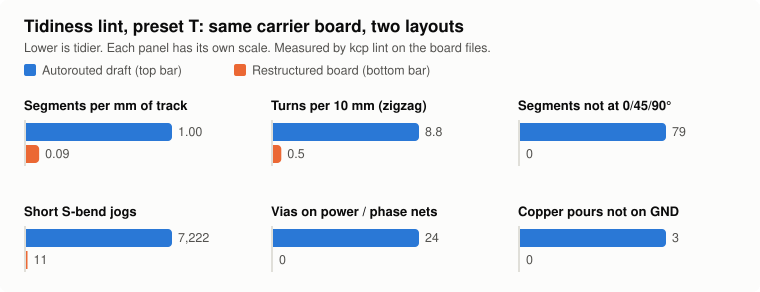

# PCB Layout with an AI Agent in KiCad (`kicad-clean-pcb`)

[](LICENSE)


[繁體中文說明](README.zh-TW.md)

**An AI agent takes your working prototype to a tidy, fab-ready KiCad board: you approve every
decision, the placement is checked on paper before routing, and tidiness is measured, not
eyeballed.**



See a complete board generated end to end with the bundled tools, from wiring plan to fab zip:
[examples/stepper-carrier-2axis](examples/stepper-carrier-2axis/) (NUCLEO-F446ZE + 2 × TMC2209,
4 layers, ERC/DRC/parity 0, no vias).

An **Agent Skill for Claude Code and OpenAI Codex**. It takes a **KiCad PCB** from a working
prototype to fab-ready **Gerber and drill files**, and keeps you in the loop:

- you choose the design style up front,
- you approve every add-on circuit in a yes/no checklist,
- you confirm the placement on a **1:1 printout before a single track is routed**.

It is **not an autorouter**. It is the workflow, layout rules and checks that make an AI agent
behave like a careful PCB designer, for hand-soldered control boards, motor-driver boards and
module carrier boards.

## Why this exists

It came out of turning a perfboard prototype into a 4-layer carrier board. The prototype had an
MCU dev board, stepper-driver modules, encoder receivers and current-sense modules.

The agent's first attempt used automatic placement and grid routing. It passed DRC, but it had:

- about 10,000 zigzag track segments,
- four copper pours,
- a layout nobody could follow.

The restructured board had about 600 segments and 30 vias, one GND plane, and a third less
board area.

The 1:1 paper check came too late, after routing. It found a USB port blocked by a header row,
a fuse holder whose pitch didn't match the real part, and a terminal block that duplicated one
already on a module. All three meant rerouting.

This skill captures what fixed those problems, so the next board doesn't repeat them:

- **Decide in writing, early.** Preferences and add-on circuits are settled before the
  schematic, in a file both sides can read (`PCB_DECISIONS.md`).
- **Place, print, confirm, then route.** Mechanical mistakes surface on paper, not after
  routing.
- **Route by function group, one group at a time.** Straight lines and 45° corners, a main
  direction per layer, few vias. Run DRC after each group.
- **Nothing unrequested.** No protection, buffers or test points the user didn't approve. And
  no silently skipped protection either.

## What's inside

- **A 7-stage workflow with 4 checkpoints:** requirements and wiring → parts and decisions →
  schematic → placement (1:1 check) → routing → verification and fab files → close-out.
- **Three design presets, plus 17 adjustable axes:** Tidy & readable, Compact / shortest,
  Robust / max electrical. The axes cover stackup, vias, pours, protection policy, current
  target, temperature-rise limit, assembly method, silkscreen, checkpoint cadence and more.
- **`PCB_DECISIONS.md`, a yes/no handshake template.** It has:
  - a scope check (mains, >60 V, Li-ion, high-speed, safety-critical),
  - your preferences,
  - one row per optional protection or add-on circuit,
  - one row per optional technical check,
  - checkpoint sign-offs and a change log.

  A blank row means "not approved".
- **Reference guides:** layout rules per style; circuit policy (add-on classes A–D, current
  ratings, reverse-polarity options, regenerated motor energy); a routing playbook with
  stackup options; verification and order-spec templates; KiCad 10 scripting notes.
- **Board tools (`kcp`)** that read the `.kicad_pcb` file directly, plus four scripts. Both are
  listed under [Tools and scripts](#tools-and-scripts). The tidiness lint turns "is this layout
  readable?" into numbers: segments per mm, zigzag turns, off-angle segments, vias on power
  nets, layer directions, non-GND pours, part-row alignment.

## Is it for you?

**Good fit**

- You have a working prototype (perfboard, breadboard, jumper wires, dev boards and modules) and
  want a real PCB.
- Low and medium-speed boards: microcontroller I/O, motor drivers, sensors, encoders,
  RS-422/RS-485, I²C/SPI/UART.
- You use Claude Code, Codex or another agent that supports Agent Skills, and you want to
  approve the important decisions yourself.

**Not a fit**

- RF, DDR, USB high-speed or other controlled-impedance designs; mains-powered or isolated
  supplies; battery charging; anything above 60 V DC; safety-critical or medical devices. The
  skill's scope check stops and says so.
- "Generate my whole board without asking me anything." This skill asks, on purpose, at four
  checkpoints.

## Requirements and version notes

| | Tested | Notes |
|---|---|---|
| KiCad | **10.0.x** | `kicad-cli` options and Gerber file naming change between versions. The skill checks `--help` and reads Gerber layers from X2 attributes instead of file extensions |
| OS | Windows 10 | macOS and Linux should work, but the paths in the docs are Windows-first and untested elsewhere |
| Python for `kcp` and the board scripts | 3.9+ (stdlib only) | Reads and writes the KiCad files directly; nothing imports `pcbnew` (deprecated, removed in KiCad 11). `kicad-cli` is used for DRC, ERC, netlists, previews and fab output |
| Python for Gerber tools | 3.8+ (stdlib only) | `gerber_readback.py` and `compare_gerbers.py` need no KiCad |
| Agents | Claude Code, Codex | Any agent that reads `SKILL.md` folders (the Agent Skills format) should work |

## Install

**Pick one method.** If you copied the skill folder into `~/.claude/skills/` before and now
install the plugin, delete `~/.claude/skills/kicad-clean-pcb` first: with both installed, the
name `kicad-clean-pcb` resolves to the copied folder and the agent may follow that older copy.
Start a new session after installing or updating, because skills and MCP tools load when a
session starts. To check, ask the agent to run `python <skill>/kcp --version`; it should print
the version in `SKILL.md`.

### Claude Code: plugin marketplace (recommended)

In a Claude Code session:

```text
/plugin marketplace add haohao-0725/PCB_Layout_with_AGENT_in_KiCAD
/plugin install kicad-clean-pcb@pcb-layout-with-agent
```

### Claude Code: copy the skill folder

```bash
git clone https://github.com/haohao-0725/PCB_Layout_with_AGENT_in_KiCAD.git
cp -r PCB_Layout_with_AGENT_in_KiCAD/skills/kicad-clean-pcb ~/.claude/skills/
```

For a single project, use `<project>/.claude/skills/` instead.

### Codex

```bash
cp -r PCB_Layout_with_AGENT_in_KiCAD/skills/kicad-clean-pcb ~/.agents/skills/
```

For a single repository, use `<repo>/.agents/skills/`. Older Codex releases read
`~/.codex/skills/`. Restart Codex after installing.

### Windows (PowerShell)

```powershell
Copy-Item -Recurse PCB_Layout_with_AGENT_in_KiCAD\skills\kicad-clean-pcb $HOME\.claude\skills\
```

## Quick start

Just describe the board. For example:

- "Turn my perfboard stepper controller into a PCB. Here are the pin map, BOM and photos."
- "Here's my KiCad schematic. Help me place it and route it so it's readable."
- "Check these Gerbers before I order them."

The agent starts with the scope check and asks you to pick a preset. Then it creates
`PCB_DECISIONS.md` in your project. From there, every checkpoint is a single message listing
everything that needs your answer.

## Design presets

| | T · Tidy & readable | C · Compact / shortest | R · Robust / max electrical |
|---|---|---|---|
| Goal | Read the layout at a glance; easy to hand-solder and modify | Smallest board, shortest connections, lowest cost | Best signal integrity, thermal margin and fault tolerance |
| Routing | Straight + 45°, one direction per layer, ordered lanes | Shortest 45° paths | As T, plus return-path rules |
| 4-layer stackup | Sig / GND / GND / Sig | Sig / GND / Power / Sig | Sig / GND / GND / Sig |
| Add-on circuits | Minimal (prototype is the baseline) | Minimal | Full protection at external interfaces |
| Current target / ΔT limit | 2 × measured / 20 °C | 2 × measured / 20 °C | Worst case / 10 °C |

You can mix and match, e.g. a tidy layout with full protection. All presets keep the 1:1 fit
check, measured footprints, native checks at zero, and a Gerber readback with a layer-order
table.

## The workflow

| Stage | Output | You confirm |
|---|---|---|
| 0. Scope, profile, preferences | `PCB_DECISIONS.md` Part A | ✔ |
| 1. Hardware list, requirements, wiring plan | Project brief | ✔ |
| 2. Parts gaps, add-on decisions | BOM, measured dimensions, yes/no rows answered | ✔ |
| 3. Schematic | ERC clean, netlist checked against the wiring plan | if needed |
| 4. Placement | Previews and a **1:1 fit-check PDF** | ✔ **no routing before this** |
| 5. Routing | Grouped routing, DRC after each group | at the end |
| 6. Verification and fab files | DRC/parity zero, Gerbers + drill + readback, order spec | ✔ |
| 7. Close-out | One rebuild entry point, archived old files, handoff notes | — |

## Tools and scripts

### Board tools: `kcp`

Any Python 3.9+, no KiCad needed except for `drc` and `erc`. Each command prints JSON, or
Markdown tables with `--markdown`. Exit code 1 means the check failed; 2 means the tool could
not run.

| Command | What it does |
|---|---|
| `inspect` | The board as JSON: outline size, layers and stackup, footprints with position, rotation, side, courtyard and pads, nets with netclass and routing stats, tracks, vias and zones. `--drc` adds unconnected items per net |
| `lint` | Tidiness score against a preset (T, C or R), pass / warn / fail per metric. Thresholds live in `kcp/presets/lint.json`; pass your own copy with `--thresholds`. Give it a layer plan (`examples/layer-plans/`) to check each layer's main direction |
| `decisions` | Blank rows in `PCB_DECISIONS.md`, in any language. `--checkpoint CP2` exits 1 while anything CP2 needs is unanswered |
| `drc`, `erc` | kicad-cli DRC / ERC summarised by type, unconnected items per net. DRC runs on a temporary copy, so nothing is written next to your board; `--refill --save` has KiCad fill the zones and save the board |
| `place` | `fit-check` (courtyard overlaps, edge distance, silkscreen past the edge, keep-outs), `move`, `row`, `edge` (courtyard and silkscreen flush with the edge). Writes refuse while KiCad has the project open |
| `route` | `path`: pad → bend points → pad, written only if every segment is 0/45/90° and keeps the netclass clearance; otherwise a list of conflicts. `lane`: crossing-free order for a lane. `cleanup`: merge collinear segments |
| `previews`, `tracedrop` | Review PDFs/PNGs (top layer drawn last; a page per outer layer when it has a pour) and the 1:1 fit-check page; voltage drop and temperature rise of a net |
| `fab` | Gerbers + drill, a zip with README.txt and SHA256SUMS.txt, and a readback of the zip against the board (size, copper layers, PTH, NPTH) |
| `new` | Starts a generator project: build, place, route and rebuild scripts for a placeholder board that passes every check, ready to replace with your wiring plan |

```bash
python skills/kicad-clean-pcb/kcp inspect board.kicad_pcb --summary --markdown
python skills/kicad-clean-pcb/kcp lint board.kicad_pcb --preset T --layer-plan examples/layer-plans/4L-S1.json --markdown
python skills/kicad-clean-pcb/kcp decisions PCB_DECISIONS.md --checkpoint CP2
python skills/kicad-clean-pcb/kcp drc board.kicad_pcb --refill
python skills/kicad-clean-pcb/kcp fab board.kicad_pcb --out-dir fab --readme order_spec.txt
python skills/kicad-clean-pcb/kcp new my_board --copper 2 && python my_board/rebuild_my_board.py
```

On the board this skill came from, the lint separates the two versions clearly:

| Metric | Autorouted draft | Restructured board |
|---|---:|---:|
| Segments per mm of track | 1.00 | 0.09 |
| Turns per 10 mm (zigzag) | 8.8 | 0.5 |
| Segments not at 0/45/90° | 79 | 0 |
| Vias on power / phase nets | 24 | 0 |
| Pours on nets other than GND | 3 | 0 |
| Worst resistor-row misalignment | 1.35 mm | 0 mm |
| Result (preset T) | fail on 11 metrics | warn (11 short S-bends to review) |

### Scripts

| Script | What it does | Run with |
|---|---|---|
| `export_previews.py` | Routing, assembly and inner-plane previews (PDF + PNG) and a 1:1 fit-check PDF on A4/A3 (same as `kcp previews`) | Python 3.9+ |
| `trace_drop.py` | Voltage drop and IPC-2221 temperature rise along a net's tracks, to each load (same as `kcp tracedrop`) | Python 3.9+ |
| `gerber_readback.py` | Layer functions and copper order from X2 attributes, board outline size, PTH/NPTH hole and slot counts, with optional expected values | Python 3.8+ |
| `compare_gerbers.py` | Geometry diff of two Gerber/drill bundles: lines, arcs, flashes, regions, holes and slots | Python 3.8+ |

```bash
# Windows example; on Windows set PYTHONUTF8=1
python skills/kicad-clean-pcb/scripts/trace_drop.py board.kicad_pcb --net +5V --source J1.1 --load U3.8=0.15 --load J5.1=0.2
python skills/kicad-clean-pcb/scripts/gerber_readback.py fab.zip --expect-size 100x80 --expect-copper 4 --markdown
python skills/kicad-clean-pcb/scripts/compare_gerbers.py old.zip new.zip
```

Run the unit tests (no KiCad needed; one integration test runs only when `kicad-cli` is installed):

```bash
python -m unittest discover -s tests -v
```

## MCP server and live mode

The same tools are available as an MCP server, one tool per `kcp` command (17 tools: inspect,
lint, decisions, DRC, ERC, place, route, previews, trace drop, fab output, Gerber readback and
compare; the table is in `SKILL.md`). Read-only tools are marked as such; tools that write say so.
The MCP tools check, place and route a board and write the fab files. Creating a schematic and a
board from nothing needs an agent that can run Python (`kcp new`).

- **Claude Code:** installing the plugin registers the server (`mcpServers` in `.claude-plugin/plugin.json`
  runs `python <plugin>/skills/kicad-clean-pcb/kcp mcp`). It needs `python` on your PATH (3.9+);
  where only `python3` exists (common on macOS and Linux), make `python` available first (for
  example `python-is-python3` on Debian/Ubuntu), or the server does not start.
- **Codex** (`~/.codex/config.toml`):

  ```toml
  [mcp_servers.kicad-clean-pcb]
  command = "python"
  args = ["/path/to/skills/kicad-clean-pcb/kcp", "mcp"]
  ```
- **Other agents:** any MCP client that starts a stdio server:
  `{"command": "python", "args": ["/path/to/skills/kicad-clean-pcb/kcp", "mcp"]}`.

With the official SDK installed (`pip install mcp`, 1.x or 2.x) the server uses it; without it, a
small built-in stdio server with the same tools runs instead, so nothing extra is required.

**Live mode (KiCad IPC API).** Pass `live` instead of a board file to `inspect`, `lint`,
`place fit-check`, `place move` and `route path` (CLI or MCP) to work on the board open in KiCad,
saved or not. Every edit is one KiCad commit named like `kcp: route X_DIR`, so one Ctrl+Z undoes
it, and nothing is written when a check fails. To use it:

1. `pip install kicad-python` (module `kipy`; 0.8 targets KiCad 10.0.6, so update KiCad first).
2. In KiCad, enable the API server: Preferences → Plugins (KiCad 9/10). It is stored as
   `api.enable_server` in `kicad_common.json`.
3. Keep KiCad running with the board open.

KiCad 10's API has no schematic commands and cannot load library footprints, so schematic work,
new footprints and fab output stay on the file backend and `kicad-cli`. Live mode is covered by
tests against a stand-in for `kipy`; it has not yet been run against a live KiCad session in this
repository.

## Saving your defaults

If you always start the same way, keep a filled Part A in a file of your own, **outside** the
installed skill folder (updates overwrite it). Start from
[`examples/defaults/PCB_PART_A_DEFAULTS.md`](examples/defaults/PCB_PART_A_DEFAULTS.md), then
point your agent at it from your global notes (`~/.claude/CLAUDE.md` for Claude Code, `AGENTS.md`
for Codex):

```markdown
## PCB work
For the kicad-clean-pcb skill, my default Part A is in ~/pcb-defaults/PCB_PART_A_DEFAULTS.md.
Copy it into each new PCB_DECISIONS.md and ask me once to confirm it.
```

At stage 0 the agent copies it into the project and asks for one confirmation instead of going
through every axis.

## Repository layout

```text
.claude-plugin/          plugin.json (also registers the kcp MCP server) + marketplace.json
skills/kicad-clean-pcb/
  SKILL.md               workflow, checkpoints, principles
  references/            preferences, layout rules, circuit policy, routing, checks, KiCad scripting, regional ordering
  assets/                PCB_DECISIONS and PROJECT_BRIEF templates
  kcp/                   board tools: inspect, lint, decisions, drc/erc, place, route, previews,
                         tracedrop, MCP server, live IPC backend (Python package, stdlib only)
  scripts/               preview, trace, readback and compare tools
  agents/openai.yaml     Codex UI metadata
examples/                saved-defaults example, layer plans for `kcp lint`
tests/                   unit tests and a hand-written test board
docs/                    README images, release steps (RELEASING.md)
pyproject.toml           packaging for `pip install` (optional; the skill folder works on its own)
```

## Limitations and disclaimer

- **Rules of thumb, not a standard.** The rules come from hand-built, low-to-medium-speed boards.
  Verify critical numbers (current, temperature, clearance) against datasheets, IPC standards
  and your fab's capabilities.
- **CAD-clean is not hardware-verified.** Passing DRC says nothing about waveforms, temperature
  or real-world plugging. Test the real board.
- **Estimates only.** `trace_drop.py` uses the IPC-2221 formula and ignores pours, pads and
  connectors.
- **What the Gerber tools skip.** They don't evaluate aperture-macro bodies or step-and-repeat
  blocks.
- **The agent never orders or pays.** It prepares files and specs; you place the order.
- **No warranty.** Provided as is under the MIT license. You are responsible for the boards you
  build.

## Contributing

Issues and pull requests are welcome. These help most:

- reports from other KiCad versions and operating systems,
- layout rules for board types not covered here,
- regional ordering notes,
- a port of the board scripts to KiCad's IPC API.

Please keep proposed rules generic. No project-specific numbers.

## License

[MIT](LICENSE)
