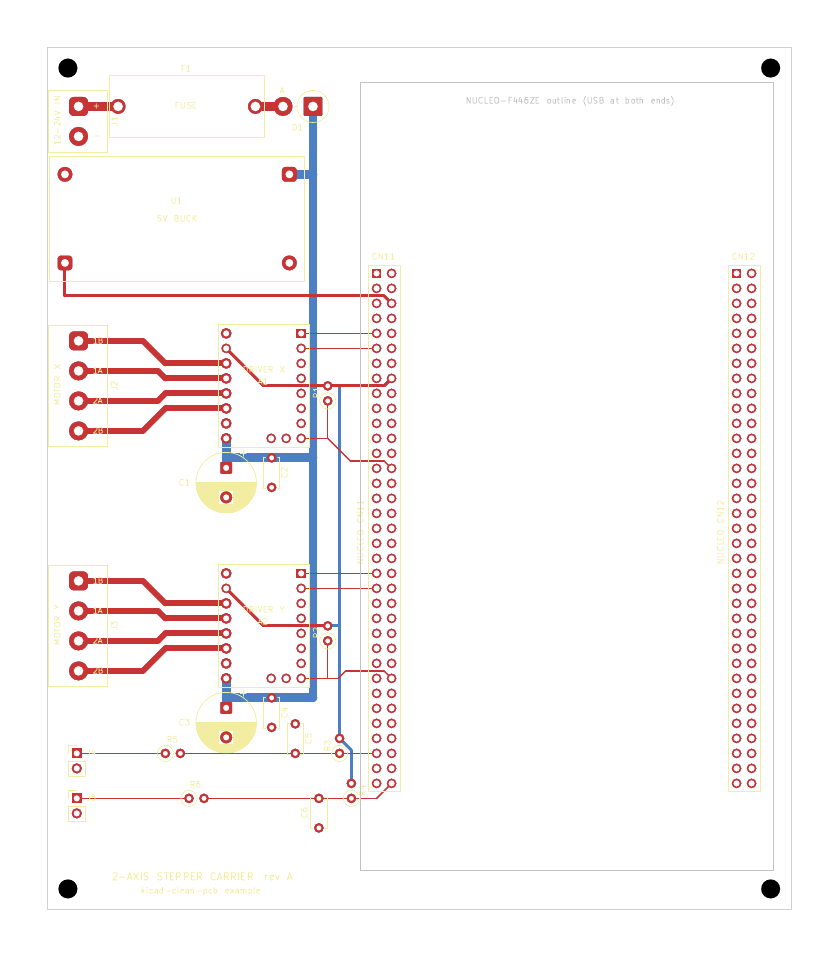

# 範例：2 軸步進馬達載板（NUCLEO-F446ZE ＋ 2 × TMC2209）

`kicad-clean-pcb` skill 從頭走完 Stage 0–6 的完整範例：接線規劃 → 原理圖 → 擺放 → 走線 → 檢查 → 製造檔。
所有 KiCad 檔都由腳本產生，**全程沒有用到 pcbnew（SWIG）**，只用 skill 內的 `kcp` 工具和 `kicad-cli`。



## 狀態

| 項目 | 結果 | 類型 |
|---|---|---|
| ERC | 0 錯誤、0 警告 | CAD 已檢查 |
| KiCad netlist 對照接線規劃 | 24 個元件、每支腳都一致 | CAD 已檢查 |
| DRC／未連線／schematic parity | 0／0／0 | CAD 已檢查 |
| via | 0 個（換層都在 THT 焊盤上） | CAD 已檢查 |
| 鋪銅 | 只有 In1.Cu、In2.Cu 兩層 GND | CAD 已檢查 |
| 整齊度 lint（預設 T、4L-S1 layer plan） | 全部 pass：每 mm 0.10 段、每 10 mm 0.41 個轉折、0 條斜角線段 | CAD 已檢查 |
| 壓降／溫升 | VM 最遠 64 mV、+5V 33 mV、最熱一段 ΔT 4.7 °C | 估算（IPC-2221，只算走線） |
| 製造檔回讀 | 126 × 146 mm、4 層、222 PTH、4 NPTH，與板子一致 | CAD 已檢查 |
| 1:1 實物比對（CP4） | 位置都正確（使用者，2026-10-30） | 實物比對 |
| LM2596 模組焊盤位置 | 1:1 列印比對位置正確；封裝尺寸原本是典型值 | 實物比對 |
| 下單 | 不下單：這塊板只用來示範工具 | — |

整齊度報告：[reports/lint.md](reports/lint.md)。決策紀錄：[PCB_DECISIONS.md](PCB_DECISIONS.md)。
專案簡報：[PROJECT_BRIEF.md](PROJECT_BRIEF.md)。下單規格：[ORDER_SPEC.md](ORDER_SPEC.md)。
實板驗收與量測紀錄（下單、組裝後填寫）：[BRINGUP.md](BRINGUP.md)。

## 板子內容

- **電源：** 12–24 V 端子 J1 → 3 A 慢熔 F1 → 串聯蕭特基 D1（反接保護）→ VM。
  VM 經 B.Cu 1.5 mm 主幹送到兩顆驅動器（各有 470 µF ＋ 100 nF）與 LM2596 降壓模組。
- **5 V：** LM2596 模組輸出接 Nucleo 的 E5V（CN11-6）。
- **驅動器：** 兩顆 MKS TMC2209 V2.0，獨立模式（MS1＝MS2＝GND 為 1/8 微步，PDN_UART 接 GND），
  EN 有 10 kΩ 上拉，MCU 拉低才致能。VIO 接 Nucleo 的 3.3 V。
- **限位：** 兩路常開開關輸入：1 kΩ 串聯 ＋ 10 nF ＋ 10 kΩ 上拉到 3.3 V。
- **版面：** 驅動器與電源在左、Nucleo 在右；所有電線從左緣進板；兩個軸用同一套模板。

## 檔案

| 檔案 | 用途 | 改什麼要改這裡 |
|---|---|---|
| `build_stepper_carrier.py` | 接線規劃（零件、每支腳的 net）、自建封裝（實測尺寸）、netclass 與設計規則 | 電路、元件值、封裝、線寬 |
| `place_stepper_carrier.py` | 板框、GND 平面、每個零件的位置、禁區、絲印 | 位置、方向、板子尺寸 |
| `route_stepper_carrier.py` | 每群一個函式：power、phases、mcu、limits | 走線 |
| `rebuild_stepper_carrier.py` | 唯一入口，從規劃一路做到製造包 | — |
| `stepper_carrier.kicad_*`、`*.kicad_sym`、`*.pretty`、`bom.csv`、`design.json` | 產生物，**不要在 KiCad 直接改** | 改上面的腳本後重建 |
| `reports/` | ERC、netlist 比對、fit check、DRC、lint、壓降、回讀 | — |
| `review/` | 走線、裝件、內層預覽（PNG＋PDF），1:1 試合 PDF | — |
| `fab/` | Gerber、鑽孔與製造壓縮包（含 README.txt 與 SHA256SUMS.txt） | — |

## 重建

先關閉 KiCad（資料夾裡有 `~*.lck` 時腳本會拒絕執行），再用任何 Python 3.9 以上執行：

```bash
python examples/stepper-carrier-2axis/rebuild_stepper_carrier.py
```

需要 KiCad 10 的 `kicad-cli`；要輸出 PNG 預覽還需要 Poppler 的 `pdftoppm`。每一步印一行 `[OK]`／`[FAIL]`，
失敗就停。完整重建約 15 秒。

## 組裝與上電

1. 先焊矮的零件（電阻、陶瓷電容、二極體），再焊排母、端子台、保險絲座、電解電容。
   D1 直立，陰極（色環）在焊盤 1（方形，VM 那側）。
2. **還沒插 Nucleo 和驅動器之前**：接上 12–24 V，把 LM2596 模組調到 5.0 V。
3. 斷電，把 Nucleo 的電源跳線設在 E5V（見 UM1974），插上 Nucleo。
   **不要把載板的 +5V 接到 CN11-18（Nucleo 的 5 V 輸出）。**
4. 斷電，依絲印方向插上驅動器（EN／VM 那一端朝下），先把 VREF 旋鈕調低。
5. 上電後才連 ST-LINK USB。插拔模組一律先斷電。

## 這個範例刻意沒做的事

- 沒有 TVS、ESD、測試點、電源 LED（精簡策略，見 PCB_DECISIONS Part B）。
- 沒有下單。下單前要先做 CP4 的 1:1 實物比對，並量好 LM2596 模組。
